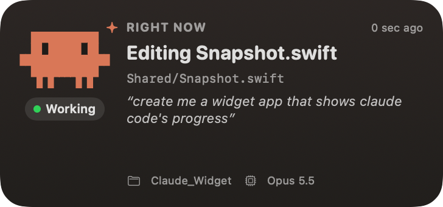
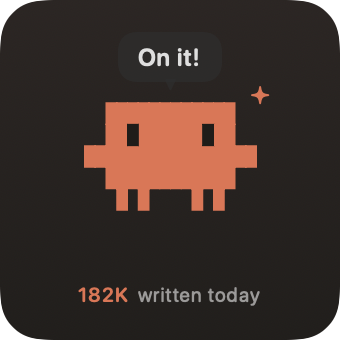
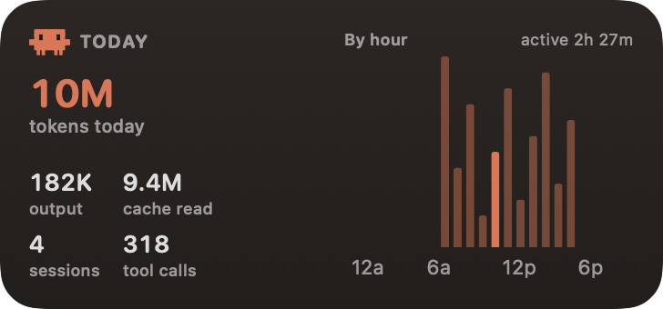
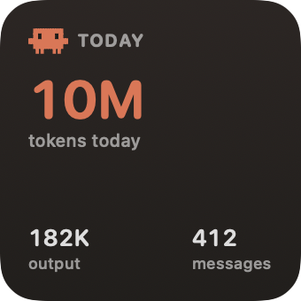
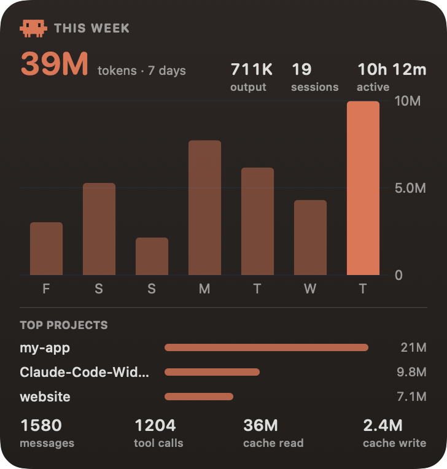

# Claude-Code-Widget

A fun little macOS app that puts your **Claude Code** usage on your desktop and in your menu bar, starring **Clawd**, the Claude Code mascot.

<p>
  
  
</p>
<p>
  
  
</p>


## Widgets

| Widget | Sizes | What it shows |
|---|---|---|
| **What Claude's Doing** | Small, Medium | Whether Claude is working, waiting for you or idle. It shows the current action ("Editing App.swift", "Running tests"), your latest prompt, the project, the model and how many sessions are active. |
| **Today's Usage** | Small, Medium | Tokens used today, with output and cache tokens, sessions, tool calls, active time and a by-hour chart. |
| **Weekly Usage** | Small, Medium, Large | A 7-day bar chart with today highlighted. The large size adds your top projects and a token breakdown. |
| **Clawd** | Small | The mascot in a speech bubble that changes with what Claude is doing: "On it!", "Your move." or "Zzz…". |

Clawd reacts in every widget. He sleeps when Claude is idle, sparkles while it works, and pops a speech bubble when it's your turn. The menu bar app also shows a dashboard where Clawd bobs and blinks.

## Install

1. Download **ClaudeWidget.zip** from the [latest release](https://github.com/Theodoreei/Claude-Code-Widget/releases/latest) and unzip it.
2. Move **ClaudeWidget.app** to your **Applications** folder.
3. Open it. The app isn't notarized by Apple, so macOS will block it the first time:
   - Go to **System Settings → Privacy & Security**, scroll down and click **Open Anyway**, or
   - run this once in Terminal:
     ```bash
     xattr -dr com.apple.quarantine /Applications/ClaudeWidget.app
     ```
4. A Clawd icon appears in the menu bar. Click it and tick **Launch at login**.
5. Add the widgets: right-click the desktop → **Edit Widgets** → search for **"Claude"**.

**Requirements:** macOS 14 Sonoma or later, and [Claude Code](https://claude.com/claude-code) used on the same Mac.

## How it works

Claude Code saves every session as a transcript in `~/.claude/projects/`. The menu bar app reads those files every 4 seconds. It only reads the lines added since the last pass, so it uses almost no CPU. From them it works out:

- **Token usage**: input, output, cache read and cache write tokens. Each API response is counted once.
- **Activity**: the latest tool Claude called, such as reading a file, running a command or searching, plus your latest prompt.
- **Active time**: time between Claude's responses, not counting breaks longer than 5 minutes.

macOS doesn't let widgets read your home folder, so the app writes a small summary file to a shared app container and asks the widgets to redraw.

> **Keep the app running.** If it's closed, the widgets keep their last numbers and show an "Open Claude Widget to refresh" note.

Everything stays on your Mac. The app makes no network requests.

### Good to know

- **Refresh delay:** macOS limits how often widgets redraw. Status changes usually show within seconds, but token counts can lag by up to about 30 seconds.
- **Days:** "Today" starts at midnight in your time zone. "This week" is the last 7 days, including today.
- **Totals include cache reads:** most of Claude Code's tokens are cache reads (re-reading the conversation), so the big totals look large. The **output** number is what Claude actually wrote.
- **No cost estimates:** the widgets show token counts only.

## Build from source

You need Xcode 16 or later. [XcodeGen](https://github.com/yonaskolb/XcodeGen) is only needed if you change `project.yml`.

```bash
git clone https://github.com/Theodoreei/Claude-Code-Widget.git
cd Claude-Code-Widget
```

**Set your own Apple Developer Team ID:** in `project.yml`, replace `W4MBZ59CH2` everywhere with your Team ID. That includes the app group name. Then regenerate the Xcode project:

```bash
xcodegen generate
```

Build it and copy it to Applications:

```bash
xcodebuild -project ClaudeWidget.xcodeproj -scheme ClaudeWidget -configuration Release -derivedDataPath build build
```

```bash
ditto build/Build/Products/Release/ClaudeWidget.app /Applications/ClaudeWidget.app
```

You can also open `ClaudeWidget.xcodeproj` in Xcode and press Run.

### Project layout

```
App/        Menu bar app: transcript scanner, dashboard, launch at login
Widgets/    WidgetKit extension: the four widgets
Shared/     Code used by both: snapshot model, formatting, Clawd drawing
Scripts/    make_icon.swift draws the app icon
project.yml XcodeGen spec for ClaudeWidget.xcodeproj
```

## Troubleshooting

- **Widgets don't show up in the gallery:** make sure the app is in `/Applications` and has been opened at least once. Then log out and back in.
- **The widgets say "Open Claude Widget to refresh":** the menu bar app isn't running. Open it, and tick **Launch at login**.
- **Everything shows zero:** check that `~/.claude/projects/` exists and has `.jsonl` files from the last week.

## Credits

Clawd and Claude Code belong to [Anthropic](https://www.anthropic.com). This is an unofficial fan project and isn't affiliated with or endorsed by Anthropic.
